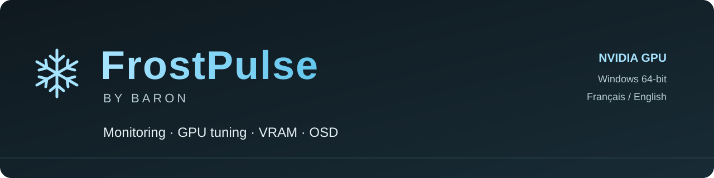
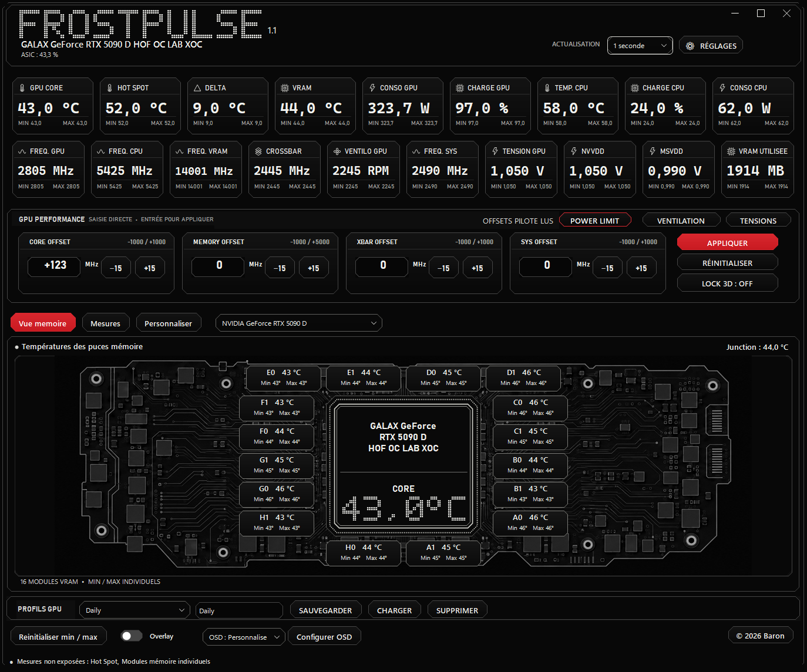
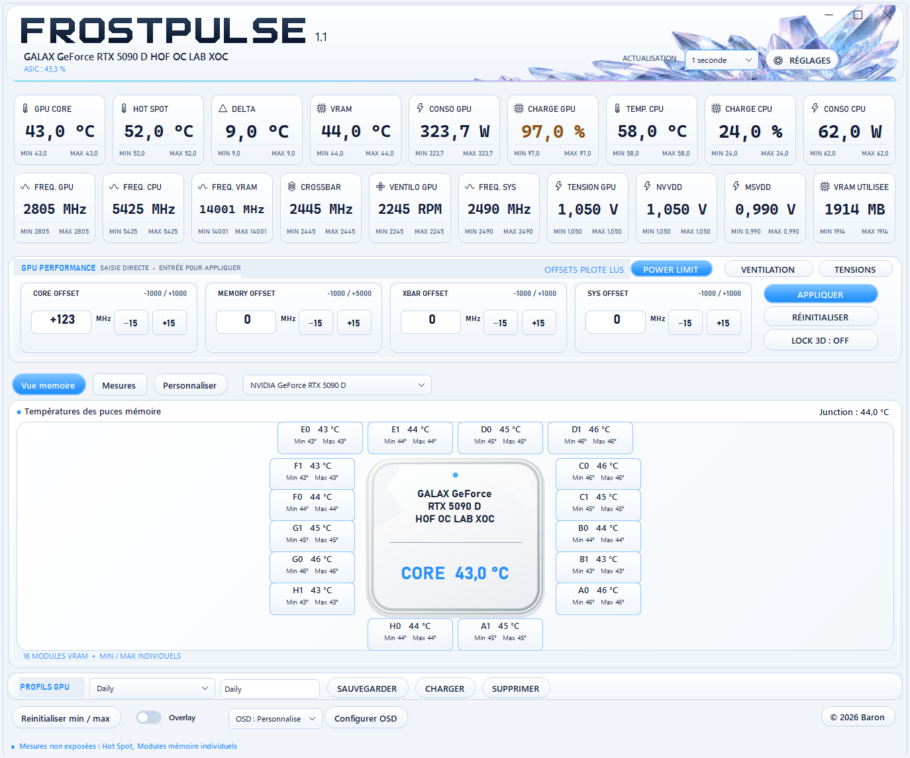
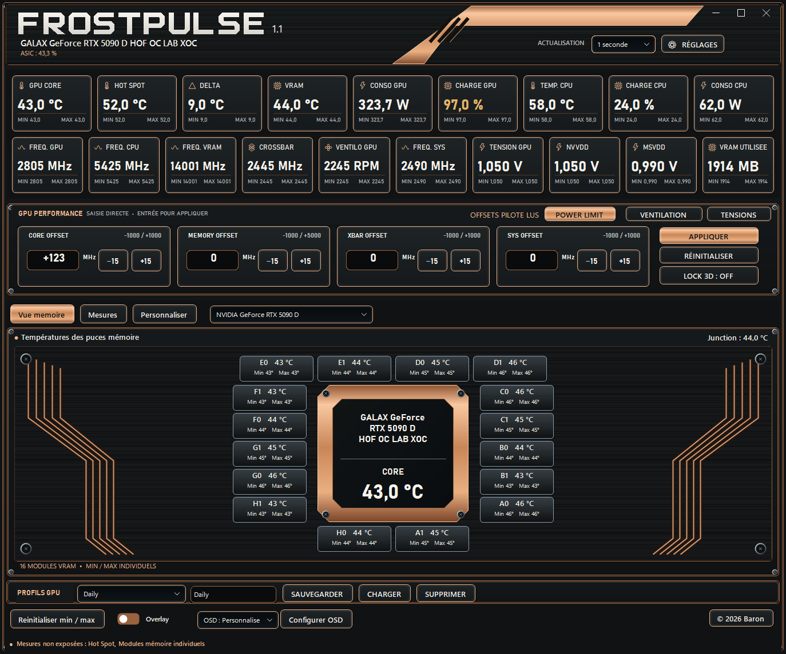
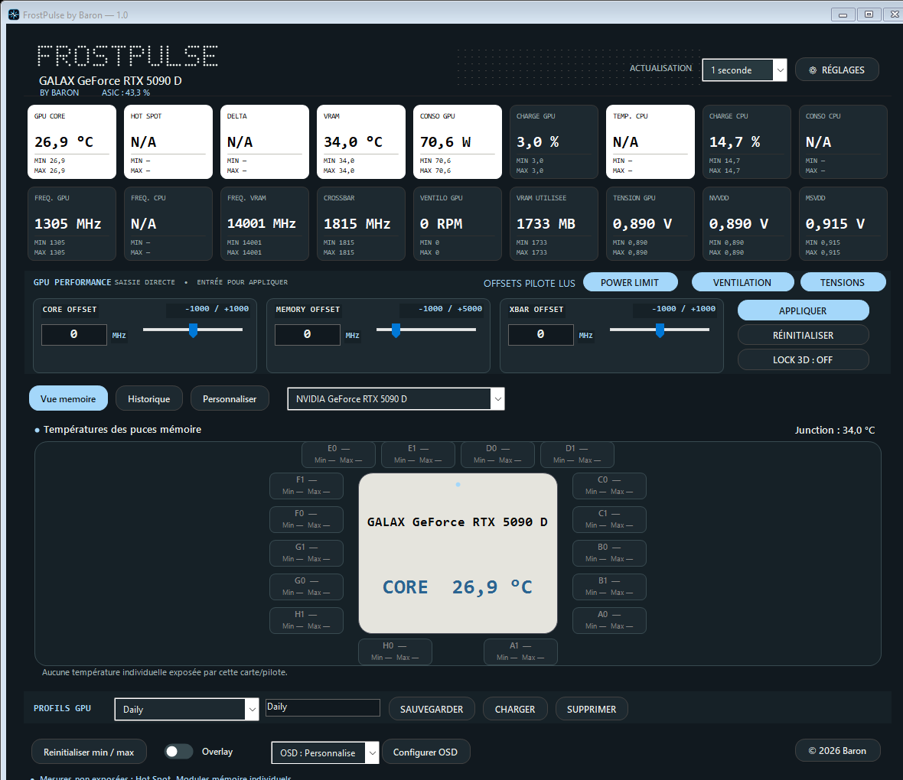

<strong><a href="https://github.com/BaronOC/FrostPulse/releases/latest">Download</a> · <a href="https://discord.gg/ETk7XmNFpB">Discord</a> · <a href="https://github.com/BaronOC/FrostPulse/discussions">Discussions</a> · <a href="https://github.com/BaronOC/FrostPulse/issues/new/choose">Report a bug</a> · <a href="README.md">Français</a></strong>

# FrostPulse by Baron

**Hardware monitoring, GPU tuning and in-game metrics in one Windows interface.**

I'm developing **FrostPulse** for hardware enthusiasts who want to understand their NVIDIA GPU, keep an eye on temperatures and access its controls in one place.

My goal is a tool that is clear enough for everyday use and detailed enough for advanced users. I also want to build a community around the project: your setups, feedback and ideas help me decide what to improve next.

*FrostPulse — Dot, one of 14 built-in styles. Application screenshot with demonstration data; available sensors and controls depend on your GPU and driver.*

## Features

### Latest Final — controls and layout · October 20, 2026

I've added **sliders for all four offsets** while keeping direct entry and **−15 / +15 MHz** buttons. Moving a slider only prepares a value; **Apply or Enter** is still required to send it to the GPU.

This Final also improves **fan controls** (aligned slider, 0% requests checked against the driver), **single-line MIN/MAX**, compact tile layouts and button press states. **Customize** now sits left of Refresh; sensor status is next to ASIC and **SENSORS** follows Expand.

[Read the full release notes and download the updated Final installer](https://github.com/BaronOC/FrostPulse/releases/tag/final-2026-10-20).

### 14 built-in skins — October 17, 2026

I've added **14 interface styles** to the Final installer across FrostPulse, HOF, Lightning, KINGPIN and Precision, including **FrostPulse — Dot** with dotted typography, a monochrome PCB and red action accents.

Choose a skin in **Settings → Interface style**. Changes apply immediately and the choice is saved. Custom tile colors are retained with improved contrast; window resizing and the style selector have also been improved.

| HOF — Blanc nacré | KINGPIN — Cuivre usiné |
| --- | --- |
|  |  |

*[Browse all 14 styles and the gallery](docs/SKINS.md) · [Download the updated Final and read the release notes](https://github.com/BaronOC/FrostPulse/releases/tag/final-2026-10-17). Screenshots use demonstration data.*

### Measurements and CSV — October 15, 2026

I've redesigned **Measurements** with multiple synchronized charts, a saved selection from **19 metrics**, and individual **minimum / average / maximum** statistics. **Expand** provides a larger view.

**Start a run** prompts for the CSV file and records samples directly to disk, with precise UTC/local timestamps and elapsed seconds. **Close the run** finalizes the CSV while retaining its charts and statistics.

See the [full release notes and updated Final installer](https://github.com/BaronOC/FrostPulse/releases/tag/final-2026-10-15).

### Version 1.1 changes — October 12, 2026

I'm releasing **FrostPulse 1.1 Final** with **SYS offset and monitoring**, **−15 / +15 MHz** buttons for Core, Memory, XBAR and SYS, and customization/OSD fixes.

SYS frequency joins the dashboard, history, CSV exports, profiles and OSD on supported setups. Older profiles remain readable. See the [full version 1.1 release notes](https://github.com/BaronOC/FrostPulse/releases/tag/v1.1.0).

### ASIC quality — added October 10, 2026

FrostPulse now displays **GPU ASIC quality** as a percentage below the GPU name, with details available through a click, tooltip and identification copy.

For this addition, I used **HWiNFO's ASIC quality reading as a reference** and checked agreement on my RTX 5090 D: **43.3%** in both applications. FrostPulse reads the data natively; **HWiNFO does not need to be installed or running**.

Availability depends on the GPU and driver. Unsupported readings show as unavailable. This index does not guarantee overclocking potential; hardware agreement has been verified on this RTX 5090 D.

View the ASIC reading validation screenshot

*Validation screenshot showing ASIC quality at 43.3%. Other measurements depend on the sensors available when the screenshot was taken.*

| Feature | What it offers |
| --- | --- |
| **GPU and CPU monitoring** | Available temperatures, hotspot and VRAM data, clocks, load, power, fan speed and memory usage. |
| **Min/max tracking** | Visible reference values throughout a session. |
| **ASIC quality** | Native reading on compatible GPUs, shown below the GPU name with details and copy support. HWiNFO was used as a comparison reference. |
| **GPU controls** | Core, Memory, XBAR and SYS offsets with sliders, direct entry and −15 / +15 MHz buttons, power limit, fan control and Lock 3D on compatible setups. |
| **Voltage controls** | Available NVVDD / MSVDD readings and controls, explicit application and restoration of initial references. |
| **PCB / VRAM view** | Memory layout and individual module readings when exposed by the GPU. |
| **History and CSV** | Synchronized charts, run statistics and live CSV recording with UTC/local timestamps and elapsed time. |
| **Profiles and customization** | 14 built-in styles, custom colors, GPU profiles, preferences and configurable OSD metrics. |
| **In-game OSD** | RTSS integration for compatible games and 3D applications. |
| **English and French** | Bilingual application and installer. |

## Download

1. Open the [latest Final release](https://github.com/BaronOC/FrostPulse/releases/latest).
2. Download **FrostPulse-1.1-Setup.exe** from **Assets**.
3. Run the installer, select your language and follow the steps.
4. Launch FrostPulse from the Start menu. A desktop shortcut is optional.

Profiles, colors, OSD settings and preferences are retained during updates.

**Release:** 1.1 Final — controls and layout · **Build:** October 20, 2026 · **Platform:** Windows 64-bit.

## Compatibility

FrostPulse targets **NVIDIA GPUs**, with a focus on **GeForce RTX 50 series** and features intended for **40, 30 and 20 series**.

Each sensor and control depends on the specific GPU, VBIOS and driver. Monitoring compatibility does not guarantee access to every advanced control. Individual VRAM temperatures are shown when the GPU actually exposes them. **RTSS is required for the in-game OSD.**

Help me document compatibility by sharing your exact GPU model, driver version and available features.

## Join the community

- Join [Discord](https://discord.gg/ETk7XmNFpB) to share your setup and meet other users.
- Use [Discussions](https://github.com/BaronOC/FrostPulse/discussions) for questions, ideas and feedback.
- Open an [Issue](https://github.com/BaronOC/FrostPulse/issues/new/choose) for reproducible bugs.
- Follow [Releases](https://github.com/BaronOC/FrostPulse/releases) for Final versions and release notes.

A star or a share helps other enthusiasts discover FrostPulse. Clear feedback, including reports about what does not work, is just as valuable.

This repository hosts Final releases, documentation and community feedback. The application's source code is not published here.

## Credits

FrostPulse by **Baron**. Hardware monitoring uses LibreHardwareMonitor; some features rely on PawnIO. The OSD integrates with RivaTuner Statistics Server. Trademarks belong to their respective owners. FrostPulse is an independent project, not an official NVIDIA product.
