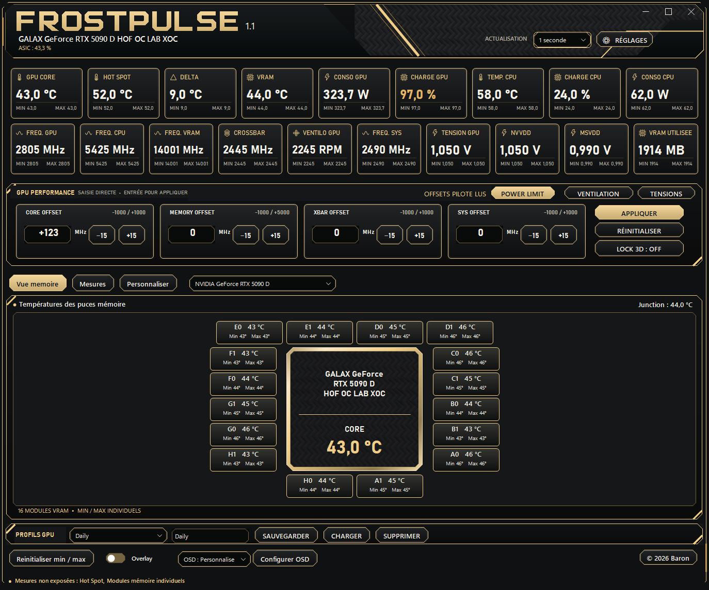
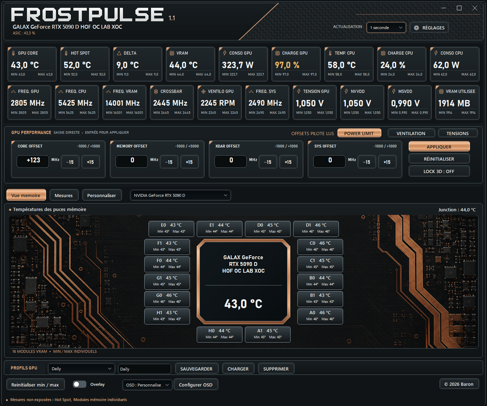
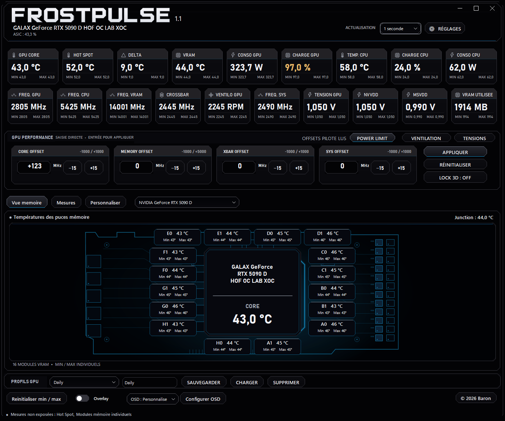

# Skins et personnalisation / Interface styles

Tous les styles sont inclus dans l'installateur Final. Choisissez votre interface dans **Réglages → Style de l'interface** : le changement s'applique immédiatement et votre choix est mémorisé.

| Collection | Styles disponibles |
| --- | --- |
| **FrostPulse** | Moderne · Dot |
| **HOF** | Blanc nacré · Cristal sombre · Polaire |
| **Lightning** | Noir & Or · Carbone · Mesures |
| **KINGPIN** | Copper · Cuivre usiné · Stealth Carbon · XOC Lab |
| **Precision** | Precision X — Classic · Precision X1 — Moderne |

**FrostPulse — Dot** associe noir et graphite, typographie à points, décor PCB monochrome et accents rouges sur les commandes actives. Les autres collections proposent des interfaces claires, cristallines, carbone, cuivre ou inspirées des instruments de monitoring.

## Galerie

*Captures du logiciel avec données de démonstration pour présenter les interfaces. Les valeurs affichées ne sont pas des résultats de benchmark.*

| FrostPulse — Dot | HOF — Blanc nacré |
| --- | --- |
|  |  |

| Lightning — Noir & Or | KINGPIN — Cuivre usiné |
| --- | --- |
|  |  |

| KINGPIN — Stealth Carbon | Precision X1 — Moderne |
| --- | --- |
|  |  |

## Couleurs et préférences

Les couleurs personnalisées des tuiles restent disponibles et leur contraste est adapté au fond choisi. Le changement de style conserve les saisies, le run/CSV, les profils et les préférences OSD. Les couleurs OSD restent indépendantes.

## English

All 14 styles are included in the Final installer. Open Settings → Interface style, select a style and the choice is applied immediately and saved. No separate pack installation is required. The screenshots show the application with demonstration data, not benchmark results. Custom tile colors, profiles, current inputs and runs/CSV are retained; OSD colors remain independent.
